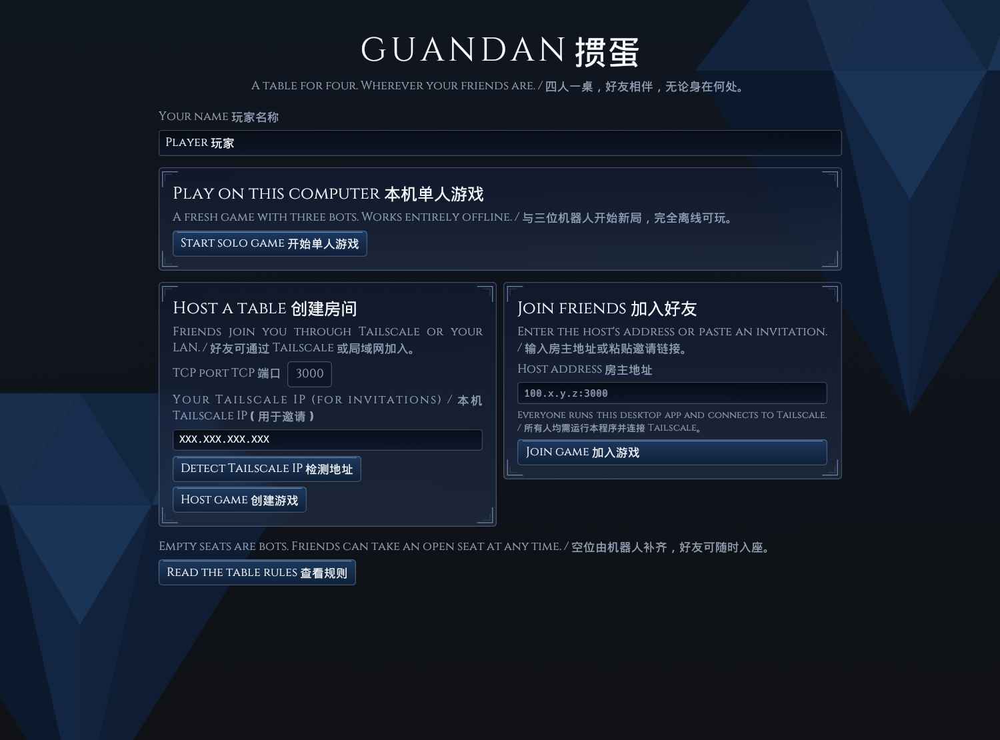
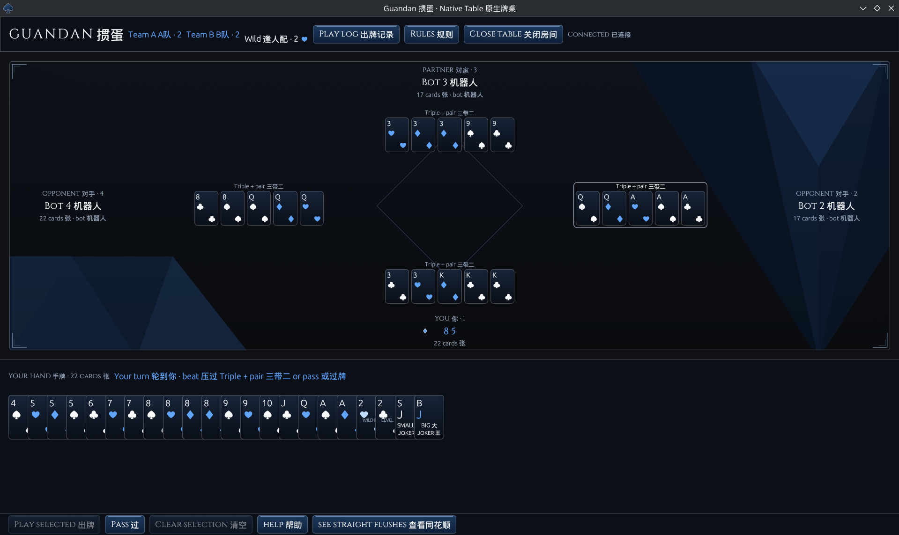

# Guandan Native

[中文说明](#中文说明)

A Rust desktop application for Linux: a native window, a Rust rules engine,
three local bots, and multiplayer over Tailscale or a LAN. The application
does not use Node.js, a browser, a webview, HTML, or a JavaScript runtime.

## Build and run

See [DEPENDENCIES.md](DEPENDENCIES.md) for the complete setup checklist, Fedora
package names, toolchain details, and the full Cargo dependency inventory.

Use a current stable Rust toolchain. This project is built and tested with
Rust 1.99.1. On Fedora, install the C build tools if needed:

```sh
sudo dnf install gcc pkgconf-pkg-config
cargo build --release --locked --bin guandan
./target/release/guandan
```

Or run directly with `cargo run --release --locked`. Cargo downloads the Rust
dependencies on the first build. Subsequent solo play requires no internet.

The output is a Linux ELF executable. Rules, interface code, instructions, and
fonts are compiled into it; no `public/` directory or Node installation is
needed beside the executable. It uses the normal Linux desktop libraries and
OpenGL driver, rather than being a statically linked, universal Linux binary.
Both Wayland and X11 backends are enabled. If a desktop/driver has a Wayland
problem, try X11 with `env -u WAYLAND_DISPLAY ./target/release/guandan`.

## Solo

Enter your name and choose **Start solo game**. An internal host listens only
on loopback, on an available port. You receive a fresh hand with three bots.

Click cards to select them, then **Play selected**, or **Pass** when following.
The selected combination is previewed beside the controls. Played cards sit in
front of their owners; a silver outline marks the current winning play. The log
has a Close button, and Escape closes the log and rules windows.

On your turn, **help** selects a suggested play using the bots' level 3 strategy,
including public card counting, pass history, and partner awareness. The button
changes to **cancel**, which clears the selection or cancels a pending request.
You can adjust the selected cards, then confirm with **Play selected**. If the
strategy recommends passing, a message appears beside the controls; choose
**Pass** to confirm. Help works in both hand views, in solo and multiplayer.
The host computes suggestions in the background. Host and guests must all use
this updated build.

Choose **see straight flushes** to arrange your hand in four suit rows with
aligned columns from 2 through Ace. Empty slots make gaps easy to see; duplicate
cards remain individually selectable. Wild hearts stay in the hearts row and
can complete any suit. Jokers remain selectable in a separate column. Scroll the
grid in small windows; the action buttons stay visible. **restore regular view**
returns to the normal hand layout and keeps your selection.

The Diamond Vault interface pairs faceted sapphire artwork with blurred navy
glass panels, platinum borders, engraved corners, recessed inputs, and blue
gradient controls. Cinzel's engraved Roman serif typography is embedded in the executable.
The interface shows Simplified Chinese beside English throughout the lobby,
table, controls, rules, help, and messages. A bundled Droid Sans Fallback font
provides Chinese glyphs, including Chinese player names, entirely offline.
Card indices retain a clear, simple face; hearts and diamonds use ice blue,
with brighter wildcard hearts. There are no warm or gold accents.
The palette and controls live in [src/app/theme.rs](src/app/theme.rs); procedural
artwork and cached glass blur are in [backdrop.rs](src/app/theme/backdrop.rs).
The bundled font and its SIL Open Font License are in [assets/fonts](assets/fonts).
No extra font installation or Rust dependency is required.

The interface adapts to window size, down to 420×340 logical pixels. Buttons
wrap, cards shrink to fit the hand, and the lobby stacks into one column in
narrow windows. Scroll the lobby to reach additional controls in short windows.
Long instructions scroll separately from the action buttons. The play log opens
as a floating window on smaller screens so it does not squeeze the hand. In very
short windows, the table can also scroll independently of the hand and controls.

## Play with friends on your tailnet

1. Everyone starts Tailscale and runs the same version of this desktop app.
2. The host chooses **Host game**. The default TCP port is **3000**.
3. Set **Your Tailscale IP** to the hosting computer's Tailscale IPv4 address.
   The app tries to detect it locally; **Detect Tailscale IP** retries. You can
   also find it with `tailscale ip -4` and type it into that field.
4. Copy the **On your tailnet** invitation from the table header. It looks like
   `guandan://XXX.XXX.XXX.XXX:3000`, using the real IP you entered.
5. Guests paste that invitation into **Host address** under **Join friends**.
   A plain `XXX.XXX.XXX.XXX:3000` or MagicDNS hostname also works. Replace the
   placeholder with the host's real Tailscale IP; there is no source edit needed.

These are invitations to paste into the desktop app, not browser links. Each
guest needs a native build on their machine. This source and verification target
Linux; the old browser client cannot join the native TCP protocol.

Allow the selected TCP port through the host's firewall and tailnet access rules.
No router port forwarding, Tailscale Serve, or Funnel setup is needed. Keep the
host application running: **Close table** shuts down the host and disconnects
everyone. Hosting listens on all IPv4 interfaces, so the same port can also be
used with the host's LAN IP. The advertised Tailscale address does not restrict
which interfaces can connect. Tailscale supplies the encrypted private transport;
the game itself does not implement a separate account or encryption system.

Empty seats are bots. A joining friend takes an open bot seat without restarting
the hand. A disconnected guest's seat becomes a bot while others remain. Use
**Reconnect** after a connection failure; you take an open seat and may not get
your original seat back. When everyone leaves, play stops; the next arrival
starts a fresh game. Bots cannot play a newly occupied human seat.

The app saves your name, invitation address, port, and host IP in
`$XDG_CONFIG_HOME/guandan/settings.json`, or `~/.config/guandan/settings.json`.
No game or hand history is persisted across host restarts.

## Rules carried over

- Two decks, 27 cards per player; seats 1 and 3 partner, as do seats 2 and 4.
- Hearts of the current level are wildcards, but cannot replace either joker.
  Pairs of matching small or big jokers are legal.
- All level-card suits rank above Ace. A level 7, including a non-heart 7,
  is excluded from ordinary 2–9 tribute returns.
- A 1–2 victory ends the hand immediately. Levels advance +3 for 1–2, +2 for
  1–3, and +1 for 1–4, stopping at Ace. A 1–2 or 1–3 win while playing your own
  Ace wins the game. Three consecutive 1–4 wins at your own Ace reset that team
  to 2; an intervening loss breaks the streak.
- The next deal includes single/double tribute, correct reciprocal returns,
  wildcard exemption, both-big-joker rebellion, and the corresponding leader.
  Human recipients choose a highlighted non-trump 2–9. If none exists, only
  their lowest non-wild card may be returned. Returns are revealed together.
- A finished player's unanswered winning play gives the lead to their partner.

The in-app **Rules** window and [RULES.txt](RULES.txt) explain the full table
conventions.

## Bots

All empty seats use the level 3 heuristic policy, entirely offline. No additional
dependencies, model downloads, or services are required.

- Plan the hand as a small number of legal plays, considering full houses, runs,
  bombs, wildcard substitutions, and alternative suits/copies of the same rank.
  Prefer combinations that leave a useful hand over simply playing the most cards.
- Preserve bombs and wildcards; spend a bomb to stop a possible opponent finish,
  finish immediately, or leave just one play. Lead low and use stronger responses
  when securing the lead helps the team.
- Use public hand sizes to help a nearly finished partner, let a partner's winning
  play stand, and avoid giving an opponent with one card an easy single.
- Count played cards by physical copy, rank, and suit, including jokers and
  wildcards. Remember revealed tribute/return cards until their owners play them.
  The action history survives trick cleanup and resets on each new deal.
- Treat passes against opponents as uncertain evidence about available responses.
  Ignore passes over a partner, weaken old evidence, and discard an inference
  contradicted by a later play. A pass never proves that a response is impossible.
- Estimate whether a play will retain control or allow an opponent to finish.
  Use exhausted high cards to conserve jokers, secure a route out in two plays,
  and stop a nearly finished opponent from regaining the lead, including by relay.

Hand planning uses memoization and a fixed work budget to keep turns responsive.
It seeks fewer plays but does not guarantee a globally optimal partition for every
27-card hand. The bot receives only its own hand, public counts, and public
actions. Return choices enter that history only when the exchange is revealed.
Individual card-count odds use exact finite-deck arithmetic; combination
probabilities and pass weights are heuristic estimates. There are no
sampled opponent hands or game rollouts; those belong to the future level 4 policy.

Repeatable comparisons use identical seeded deals twice, swapping policies
between teams, across levels 2 through Ace. Level 2 won **151/200 hands (75.5%)**
against the original policy. Level 3 won **518/1,000 hands (51.8%)** against level
2, across seeds 0–499. Its slowest decision in those release-build runs was about
23 ms. The measured gain over level 2 is modest; strength and timing vary by deal
and machine. The earlier policies remain available for reproducible comparisons:

```sh
cargo test --release --locked --no-default-features --test bots compare_against_baseline -- --ignored --nocapture
GUANDAN_BENCHMARK_DEALS=500 cargo test --release --locked --no-default-features --test bots compare_tracking_against_level_two -- --ignored --nocapture
```

The tracking comparison defaults to 100 deals (200 hands). Set
`GUANDAN_BENCHMARK_START` to select another starting seed.

## Verification

```sh
cargo test --locked
cargo clippy --all-targets --all-features --locked -- -D warnings
cargo fmt --all --check
```

Tests include legacy combination fixtures, rules/tribute/Ace regressions,
30 seeded full-game simulations with card-conservation checks, bot tactical
regressions, small-hand planning checked against an exhaustive solver, complete
games using the new bots through scoring/tribute, card counting and cautious
pass inference, exhaustive checks of small endgames at every level, public-history
reset/reveal behavior, seat ownership and privacy,
and a real TCP test where four native clients finish a hand, exchange tribute,
resume play, and detect host shutdown.

The engine and networking can also be tested without graphical dependencies:

```sh
cargo test --no-default-features --locked
```

For interface previews, `cargo run --locked -- --demo` opens a static native
table. Optional screenshot verification uses:

```sh
cargo build --features screenshot --locked --bin guandan
EFRAME_SCREENSHOT_TO=/tmp/guandan.png ./target/debug/guandan --demo
```

For a compact screenshot, also set `GUANDAN_SCREENSHOT_SIZE=420x340` (available
only when building with the `screenshot` feature).

## Source layout

- `src/cards.rs`, `src/rules.rs`: cards, combination validation, basic move generation.
- `src/bot.rs`: hand planning, partnership/bomb heuristics, and endgame choices.
- `src/bot/knowledge.rs`: public card counts, pass evidence, and response estimates.
- `src/game.rs`: scoring, turns, tribute, rebellion, and Ace progression.
- `src/table.rs`: authoritative seats, bot timers, per-client public/private views.
- `src/net.rs`: background TCP hosting/client connections and versioned protocol.
- `src/app.rs`, `src/main.rs`: the native graphical application.
- `src/app/theme.rs`, `src/app/theme/backdrop.rs`: Diamond Vault styling, serif typography, sapphire facets, and cached glass blur.
- `src/i18n.rs`: shared English / Simplified Chinese interface and error text.
- `assets/fonts/`: embedded Cinzel and Droid Sans Fallback, with their licenses/notices.
- `tests/`: game, migration parity, and real network tests.
- `legacy/`: the previous web application, preserved for reference. It is not
  compiled or launched by Cargo. Its Node tests remain runnable there.

An optional headless host is included:

```sh
cargo run --release --no-default-features --locked --bin guandan-server -- 0.0.0.0:3000
```

Guests still join it using the desktop app. The normal **Host game** button
already runs the same server internally; a separate server process is optional.

## Desktop launcher and navy spade icon

The window icon is embedded in the executable. Wayland also looks up the icon
through an installed desktop entry matching the application's ID. Build and
install the game, launcher, and navy spade icon for your user:

```sh
cargo build --release --locked --bin guandan
sh packaging/install-desktop.sh
```

Relaunch the game after installation. The installer copies the binary to
`~/.local/bin/guandan`, writes an absolute executable path into the launcher,
and installs the launcher and icons beneath `$XDG_DATA_HOME` (normally
`~/.local/share`). No root access or additional Rust dependency is needed.
Rerun it after rebuilding to update the installed executable. To install a
different build, pass its path, e.g. `sh packaging/install-desktop.sh target/debug/guandan`.
Some desktops keep pinned shortcuts cached; unpin and repin Guandan if an old
shortcut retains its previous icon. The original vector and bundled PNG are in
`assets/icons/`.

---

# 中文说明

掼蛋原生版是一款使用 Rust 编写的 Linux 桌面应用，包含原生图形窗口、Rust 规则引擎、
三位本机机器人，以及通过 Tailscale 或局域网进行的多人联机。
程序不使用 Node.js、浏览器、WebView、HTML 或 JavaScript 运行时。
首页、牌桌、按钮、规则、帮助及消息均将简体中文显示在英文旁，
中文玩家名称也可正常显示。中文后备字体已嵌入程序，无需联网下载或另装字体。

## 编译与运行

完整的安装清单、Fedora 软件包名、工具链说明及 Cargo 依赖列表见
[DEPENDENCIES.md](DEPENDENCIES.md#中文依赖说明)。

请使用当前稳定版 Rust 工具链。本项目使用 Rust 1.99.1 编译和测试。
Fedora 上如尚未安装 C 编译工具，可运行：

```sh
sudo dnf install gcc pkgconf-pkg-config
cargo build --release --locked --bin guandan
./target/release/guandan
```

也可直接使用 `cargo run --release --locked`。Cargo 会在首次编译时下载 Rust 依赖，
之后单人游戏无需联网。生成的程序是 Linux ELF 可执行文件；规则、界面、说明和字体
均编译在程序内，旁边无需放置 `public/` 目录，也无需安装 Node。
程序依赖 Linux 桌面图形库及 OpenGL 驱动，并非可通用于所有 Linux 发行版的全静态二进制。
Wayland 与 X11 后端均已启用。如 Wayland 或驱动出现问题，可尝试：

```sh
env -u WAYLAND_DISPLAY ./target/release/guandan
```

## 单人游戏与界面

输入玩家名称，点击 **Start solo game（开始单人游戏）**。
程序会在本机回环地址的可用端口启动内部房主，为你与三位机器人发一副新牌。

点击手牌进行选择，再点击 **Play selected（出牌）**；跟牌时可点击 **Pass（过）**。
按钮旁会显示所选牌型。每位玩家打出的牌显示在其座位前，银色轮廓标记当前最大出牌。
出牌记录有关闭按钮，Esc 可关闭记录及规则窗口。

轮到你时，**help（帮助）** 会使用与机器人相同的三级策略建议出牌，考虑公开牌数、
过牌记录和对家情况。按钮随后变为 **cancel（取消）**，可清空选择或放弃尚未返回的建议。
你也可以手动调整选牌，再点击出牌确认。如果建议过牌，按钮旁会显示提示，
仍须由你点击过牌确认。普通与同花顺视图、单人与多人游戏都支持帮助。
建议由房主在后台计算，房主和所有好友须使用此更新版本。

**see straight flushes（查看同花顺）** 会将手牌按四种花色分行，并按牌面 2–A 对齐。
空位表示缺牌，两副牌中的同点数同花色牌仍可分别选择。
逢人配保留在红桃行，但可补任意花色；王保留在单独一列。
小窗口可滚动网格，操作按钮始终留在窗口内。
**restore regular view（恢复普通视图）** 会恢复通常排列并保留当前选牌。

Diamond Vault（钻石密室）主题使用蓝宝石切面背景、模糊深蓝玻璃面板、铂银边框、
角部刻纹、内凹输入框和蓝色渐变按钮。Cinzel 罗马风格衬线字体与 Droid Sans Fallback
中文后备字体均嵌入可执行文件。牌角点数及花色保留清晰的简洁字体；红桃与方块使用冰蓝色，
逢人配红桃更亮。界面没有暖色或金色点缀。
配色与控件位于 [src/app/theme.rs](src/app/theme.rs)，切面背景与玻璃模糊缓存位于
[backdrop.rs](src/app/theme/backdrop.rs)，字体及许可证见 [assets/fonts](assets/fonts)。
无需额外安装字体或增加 Rust 依赖。

界面可适应不同窗口尺寸，最小为 420×340 逻辑像素。按钮会换行，手牌会缩放，
首页在窄窗口中改为单列；较矮时可滚动首页以访问更多控件。
长说明与操作按钮分别滚动，小窗口中的出牌记录以浮动窗口打开，避免挤压手牌。
牌桌在很矮的窗口中也可独立滚动。

## 通过 Tailscale 与好友联机

1. 所有人启动 Tailscale，并运行同一版本的桌面程序。
2. 房主选择 **Host game（创建游戏）**，默认 TCP 端口为 **3000**。
3. 在 **Your Tailscale IP（本机 Tailscale IP）** 中输入房主电脑的 Tailscale IPv4 地址。
   程序会尝试自动检测；可点击 **Detect Tailscale IP（检测地址）** 重试，
   也可运行 `tailscale ip -4` 后手动填写。
4. 房主复制牌桌顶部 **On your tailnet（组网邀请）** 的邀请，
   形如 `guandan://XXX.XXX.XXX.XXX:3000`，其中会使用你填写的实际 IP。
5. 好友在 **Join friends（加入好友）** 中的 **Host address（房主地址）** 粘贴邀请。
   普通 `XXX.XXX.XXX.XXX:3000` 或 MagicDNS 主机名同样可用。
   请将示例占位符换成真实 IP，无需修改源代码。

邀请应粘贴到桌面程序中，并不是浏览器网页链接。每位玩家都需要本机原生程序。
当前源代码和验证目标为 Linux，旧版浏览器客户端不能加入原生 TCP 协议的房间。

房主防火墙和 tailnet 访问规则须允许所选 TCP 端口。
无需路由器端口转发、Tailscale Serve 或 Funnel。房主须保持运行，
**Close table（关闭房间）** 会关闭房主并断开所有玩家。
联机房主监听所有 IPv4 网卡，因此也可以用房主局域网 IP 访问同一端口；
邀请中填写的 Tailscale IP 不会限制监听网卡。
加密的私有网络传输由 Tailscale 提供，游戏本身没有额外的账户或加密系统。

空位由机器人补齐，好友可在不中断当前局的情况下接替空位。
其他真人仍在时，掉线玩家由机器人接管。
掉线后可点击 **Reconnect（重新连接）**；重新加入将占用空位，不保证恢复原座位。
所有真人离开后停止出牌，下一位入座者会开始全新比赛。
机器人不会替已被真人占用的座位出牌。

程序将名称、邀请地址、端口和房主 IP 保存到
`$XDG_CONFIG_HOME/guandan/settings.json`，未设置该变量时则使用
`~/.config/guandan/settings.json`。房主重启后不会保留比赛或牌局历史。

## 游戏规则

- 两副牌，每人 27 张；1 号与 3 号为一队，2 号与 4 号为另一队。
- 当前级数的两张红桃为逢人配，不能代替王。两张小王或两张大王可以组成对子。
- 所有花色的级牌都大于 A。打 7 时，非红桃的 7 同样不能作为普通 2–9 还牌。
- 同队一二名时立即结束本局。一二名升 3 级，一三名升 2 级，一四名升 1 级，最高停在 A。
  本队打 A 时，以一二名或一三名获胜即赢得比赛；连续三次一四名获胜则退回 2，输局会中断计数。
- 下一局有单贡或双贡，收贡者须向原进贡者还牌。逢人配免贡，两张大王可触发抗贡，
  并按相应规则确定首出者。真人收贡者选择高亮的非级牌 2–9；若没有，则只能还最小非逢人配牌。
  双贡的两张还牌同时公开。
- 已出完的玩家赢得出牌权时，由其对家接风首出。

完整约定请查看程序内的 **Rules（规则）** 窗口或 [RULES.txt](RULES.txt)。

## 机器人策略

所有空位均使用完全离线的三级启发式策略，无需额外依赖、下载模型或连接外部服务。

- 将手牌规划为较少的合法出牌，考虑三带二、连牌、炸弹、逢人配替代及相同点数的不同花色或实体牌。
  优先保留有利的剩余手牌，而不是单纯一次出最多张。
- 保留炸弹和逢人配，在阻止对手可能出完、自己直接出完或仅剩一次出牌时使用炸弹。
  首出偏向小牌；需要为队伍争取出牌权时使用较强跟牌。
- 利用公开余牌数帮助即将出完的对家，适时让对家保持领先，避免给仅剩一张的对手送单张。
- 按实体牌、点数、花色记录已出牌，包括王和逢人配；公开的进贡、还牌在被打出前保留已知归属。
  清理一轮牌桌显示不会清除历史，每次重新发牌时才清空。
- 将对手过牌视为不确定证据，忽略对家相互让牌，减弱较旧证据，并放弃被后续出牌推翻的推断。
  过牌永远不能证明某种跟牌绝对不存在。
- 估计出牌能否维持控制或让对手出完。利用已耗尽的大牌节省王、争取两次出完的路线，
  并阻止即将出完的对手重新获得出牌权，包括接风后的风险。

手牌规划使用记忆化缓存和固定工作预算保证响应速度，目标是减少出牌次数，
但不保证为所有 27 张手牌求出全局最优拆法。机器人只接收自己的手牌、公开余牌数和公开动作；
还牌选择在交换公开后才进入历史。单类牌数概率使用有限牌堆的精确计算，
组合概率与过牌权重仍为启发式估计。当前不采样对手手牌，也不进行整局模拟搜索，
这些属于未来的第四级策略。

可重复对比使用相同种子发牌，每副牌交换双方策略各打一次，覆盖 2 到 A。
二级策略对最初策略取得 **151/200 局（75.5%）** 胜率；三级对二级在种子 0–499 上取得
**518/1,000 局（51.8%）** 胜率。这些 release 测试中的最慢决策约为 23 毫秒。
三级相对二级的实测增益较小，强度和耗时会因发牌与机器而变。早期策略保留用于复现对比：

```sh
cargo test --release --locked --no-default-features --test bots compare_against_baseline -- --ignored --nocapture
GUANDAN_BENCHMARK_DEALS=500 cargo test --release --locked --no-default-features --test bots compare_tracking_against_level_two -- --ignored --nocapture
```

跟踪策略对比默认使用 100 副牌（200 局），可用 `GUANDAN_BENCHMARK_START` 选择起始种子。

## 验证与预览

```sh
cargo test --locked
cargo clippy --all-targets --all-features --locked -- -D warnings
cargo fmt --all --check
```

测试覆盖旧版牌型样例、规则、进贡与打 A 回归、30 个固定种子的完整比赛及牌数守恒，
机器人战术、小手牌与穷举拆牌求解器对照、完整的计分和进贡流程、记牌与谨慎过牌推断，
各级数的小残局穷举核对、公开历史清空和还牌公开、座位归属与隐私，
以及四个真实原生 TCP 客户端完成一局、交换贡牌、恢复出牌并检测房主关闭的测试。

不启用图形依赖也可测试引擎与网络：

```sh
cargo test --no-default-features --locked
```

`cargo run --locked -- --demo` 会打开静态牌桌预览。可选截图验证方法如下：

```sh
cargo build --features screenshot --locked --bin guandan
EFRAME_SCREENSHOT_TO=/tmp/guandan.png ./target/debug/guandan --demo
```

紧凑窗口截图可额外设置 `GUANDAN_SCREENSHOT_SIZE=420x340`，此设置仅对 `screenshot`
功能编译生效。

## 源代码结构

- `src/cards.rs`、`src/rules.rs`：牌、牌型验证与基础候选出牌生成。
- `src/bot.rs`：手牌规划、搭档与炸弹策略、残局选择。
- `src/bot/knowledge.rs`：公开记牌、过牌证据与跟牌概率估计。
- `src/game.rs`：计分、轮次、进贡、抗贡与打 A 升级。
- `src/table.rs`：权威座位状态、机器人计时及各客户端的公开和私有视图。
- `src/net.rs`：后台 TCP 房主、客户端连接与带版本号的协议。
- `src/app.rs`、`src/main.rs`：原生图形程序。
- `src/i18n.rs`：共享的英文与简体中文界面、错误文本。
- `src/app/theme.rs`、`src/app/theme/backdrop.rs`：Diamond Vault 主题、字体、蓝宝石切面与玻璃模糊缓存。
- `assets/fonts/`：嵌入的 Cinzel、Droid Sans Fallback 字体及版权许可证。
- `tests/`：规则、迁移一致性与真实网络测试。
- `legacy/`：仅供参考的旧版 Web 应用，不会由 Cargo 编译或启动；其 Node 测试仍可单独运行。

可选的无界面房主：

```sh
cargo run --release --no-default-features --locked --bin guandan-server -- 0.0.0.0:3000
```

好友仍使用桌面程序加入。普通 **Host game（创建游戏）** 按钮已在内部启动同一房主，
一般不需要另开服务器进程。

## 桌面启动器与藏蓝色黑桃图标

窗口图标已嵌入可执行文件。Wayland 还需要安装与应用 ID 匹配的桌面入口来查找图标。
编译并为当前用户安装程序、启动器与图标：

```sh
cargo build --release --locked --bin guandan
sh packaging/install-desktop.sh
```

安装后重新启动游戏。安装器将程序复制到 `~/.local/bin/guandan`，
在启动器中写入程序绝对路径，并将启动器与图标安装到 `$XDG_DATA_HOME`
（通常为 `~/.local/share`）下，无需 root 权限或额外 Rust 依赖。
重新编译后须再次运行安装器以更新已安装程序。
也可指定其他编译结果，例如 `sh packaging/install-desktop.sh target/debug/guandan`。
部分桌面会缓存固定到任务栏的旧图标，此时取消固定并重新固定即可。
原始矢量图及嵌入的 PNG 位于 `assets/icons/`。

## Screenshots / 界面截图

### Home page / 首页



### Gameplay / 游戏实况


